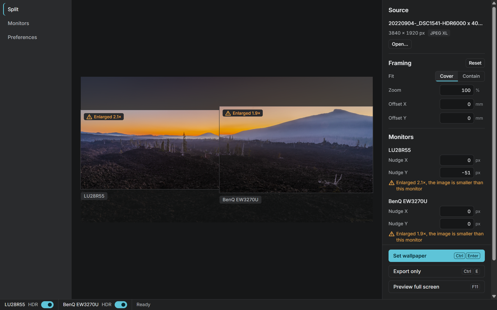
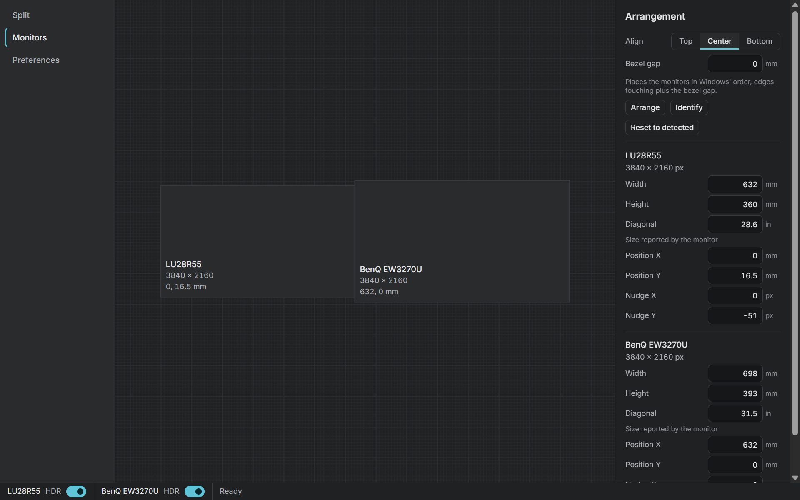
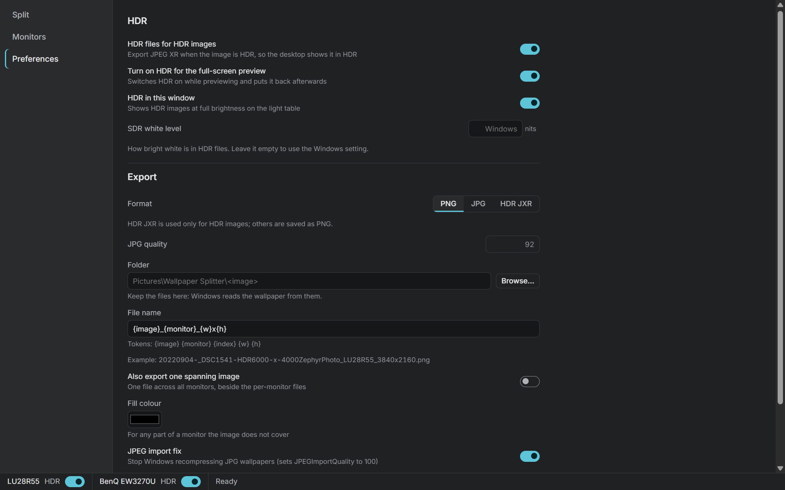

# Wallpaper Splitter

Split one image into a wallpaper for each monitor, so the picture continues across the gap as if your monitors were one window. This works even when they are different sizes, resolutions and pixel densities.



- Monitors are measured in millimetres. Physical size is read from each monitor, and you can correct it by hand.
- Bezel gaps and per-monitor nudges are supported.
- Preview in the app and full screen on every monitor, with an alignment grid.
- Exports named files (PNG, JPG, or HDR JPEG XR from HDR sources) and sets each monitor's wallpaper.
- Opens Lightroom HDR exports (Ultra HDR JPEG, AVIF, JPEG XL), 16-bit PNG and TIFF, and everyday JPG, PNG and WebP.
- Can switch a monitor's HDR on and off. It remembers your last image, framing and settings.

Windows 11 only. Runs as a portable exe with no installer.

## Download

1. Open the [latest release](https://github.com/jimjohnbeebe-jpg/Wallpaper_Splitter/releases/latest) and download `WallpaperSplitter-<version>.exe`.
2. Optional: check the download against `SHA256SUMS.txt` from the same release. Run this in PowerShell in your Downloads folder:

   ```powershell
   (Get-FileHash .\WallpaperSplitter-1.0.0.exe -Algorithm SHA256).Hash
   ```

   The result should match the line in `SHA256SUMS.txt` (case does not matter).
3. Put the exe anywhere you like and run it.

The exe is not code-signed, so Windows SmartScreen may warn the first time. Click **More info**, then **Run anyway**.

## Use

1. **Open an image.** Press **Ctrl+O**, drag a file onto the window, or pick one from Recent.
2. **Check your monitors.** On the **Monitors** page, each monitor is drawn to scale. If a size looks wrong, measure the visible screen area and type in the width and height. Set the bezel gap, and choose Top, Center or Bottom to line the monitors up. **Identify** shows each monitor's number on its screen.

   

3. **Frame the picture.** On the **Split** page, drag to pan and scroll to zoom. Choose Cover (fill every monitor) or Contain (show the whole image). An amber **Enlarged** badge means the image is smaller than that monitor and will be scaled up.
4. **Preview full screen** with **F11**. Press **G** for a millimetre grid that should run straight across the bezels. Use **Tab** to pick a monitor and the arrow keys to nudge its picture (hold **Shift** for 10 px). **Esc** closes the preview.
5. **Set wallpaper** with **Ctrl+Enter**. The files are written to `Pictures\Wallpaper Splitter\<image name>\` and set on each monitor. **Export only** (**Ctrl+E**) writes the files without changing the wallpaper.

Leave the exported files where they are: Windows reads the wallpaper from them.

### Keys

| Where | Key | Does |
|---|---|---|
| Anywhere | Ctrl+O | Open an image |
| Split | Ctrl+Enter | Export and set the wallpaper |
| Split | Ctrl+E | Export only |
| Split | F11 | Full-screen preview |
| Light table | Arrow keys (Shift: 10x) | Pan |
| Light table | + and − | Zoom |
| Light table | Tab | Select the next monitor |
| Preview | G | Alignment grid |
| Preview | Tab, then arrow keys (Shift: 10 px) | Select a monitor and nudge it |
| Preview | Esc | Close the preview |

## HDR

- **HDR images** are Ultra HDR JPEGs (gain-map JPEGs, as Lightroom exports), HDR AVIF and HDR JPEG XL.
- **HDR wallpaper.** With **HDR files for HDR images** on, an HDR image exports as JPEG XR, which Windows shows in HDR on a monitor with HDR on. SDR images always export as PNG or JPG.
- **HDR switch.** The footer has an HDR switch for each monitor. It is greyed out on a monitor without HDR support. The full-screen preview can switch HDR on by itself and puts it back afterwards (Preferences, **Turn on HDR for the full-screen preview**).
- **AVIF** is decoded by Windows. If an AVIF will not open, install the **AV1 Video Extension** and the **HEIF Image Extensions** from the Microsoft Store.



## Your data

- Settings: `%APPDATA%\WallpaperSplitter\settings.json`
- Preview cache (TIFF and JPEG XL): `%LOCALAPPDATA%\WallpaperSplitter\cache`
- WebView data: `%LOCALAPPDATA%\com.jimbeebe.wallpapersplitter`

To remove the app, delete the exe and those three folders. The Microsoft Store version keeps the same files inside its own package folder, and Windows removes them when you uninstall it. The app itself makes no network requests.

## Thanks

[Superpaper](https://github.com/hhannine/superpaper) showed how to correct for monitor size and bezels when spanning a wallpaper. Wallpaper Splitter takes that idea and adds HDR and a single portable exe.

## Build from source

Needs Node 24 and Rust 1.99.

```powershell
npm ci
npm run build   # → src-tauri\target\release\WallpaperSplitter.exe
```

## License

MIT. The Inter font is under the SIL Open Font License 1.1 (`ui/fonts/LICENSE`). The photograph in the screenshots is © Jim Beebe, all rights reserved, and is not covered by the MIT licence.

If it's useful to you, a ⭐ on the repo helps.
